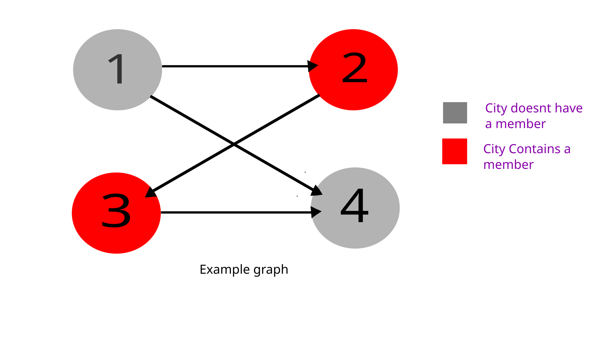

# LOJ-1111: Best Picnic Ever
---
**প্রবলেমটা কী চাচ্ছে** : _K_ জন ব্যক্তি _N_ সংখ্যক শহরে বনভোজনে যাবে। শহরগুলো _M_ সংখ্যক একমুখী রাস্তা দ্বারা সংযুক্ত। প্রবলেমটি হলো সেই শহরগুলোর সংখ্যা খুঁজে বের করা যেখানে সকল সদস্য পৌঁছাতে পারবে।

**সমাধানের সাধারণ পদ্ধতি :** এটি একটি গ্রাফ প্রবলেম। যদি আমরা শহরগুলোকে নোড এবং রাস্তাগুলোকে এজ হিসেবে চিন্তা করি, তাহলে আমরা খুব সহজেই প্রত্যেক সদস্যের শহর থেকে গ্রাফ ট্রাভার্স করতে পারি। এবং যতবার আমরা কোনো নোড বা শহর ট্রাভার্স করব, ততবার যদি আমরা সেই নোডের কাউন্ট (কতবার সেটি ভিজিট করা হয়েছে) বৃদ্ধি করি, তাহলে আমরা সহজেই বের করতে পারব কোন শহরগুলোতে সকল সদস্য পৌঁছাতে পারবে।

আসুন প্রবলেমটির বিবরণে দেওয়া উদাহরণটি বিশ্লেষণ করি।

উদাহরণে, ২ জন সদস্য ২য় এবং ৩য় শহরে বসবাস করে। মোট ৪টি শহর এবং ৪টি রাস্তা আছে। উদাহরণস্বরূপ গ্রাফটি দেখতে এইরকম:



ছবিতে আমরা দেখতে পাচ্ছি যে শুধুমাত্র দুটি শহর (৩য় ও ৪র্থ) সকল সদস্যের দ্বারা পৌঁছানো সম্ভব।
২ নং শহরের সদস্য ২ -> ৩ -> ৪ পথে যেতে পারে।
৩ নং শহরের সদস্য ৩ -> ৪ পথে যেতে পারে।

এটি দেখায় যে শুধুমাত্র ৩ এবং ৪ নং শহরে সকল সদস্য পৌঁছাতে পারবে। তাই উত্তর হবে ২।

প্রবলেম সমাধানের জন্য পদক্ষেপ:
  1. ইনপুট গ্রহণ এবং উপযুক্ত ডেটা কাঠামোতে সংরক্ষণ করা।
  2. গ্রাফের জন্য অ্যাডজেসেন্সি তালিকা তৈরি করা।
  3. যে নোডগুলোতে সদস্য রয়েছে, সেখান থেকে BFS ব্যবহার করা।
  4. প্রতিটি নোড কতজন সদস্য ভিজিট করতে পারবে তা চিহ্নিত করা।
  5. যে নোডগুলো সকল সদস্য দ্বারা ভিজিট করা যায় তার সংখ্যা আউটপুট করা।

** রিসোর্স :**
  * [Basic BFS implementation](https://origin.geeksforgeeks.org/bfs-using-stl-competitive-coding/)
  * [BFS visualization by William Fiset](https://www.youtube.com/watch?v=oDqjPvD54Ss)
  * [BFS Wikipedia](https://en.wikipedia.org/wiki/Breadth-first_search)
  * [Set in C++](https://www.geeksforgeeks.org/set-in-cpp-stl/)
  * [Vector in C++](https://www.geeksforgeeks.org/vector-in-cpp-stl/)
  * [Queue in C++](https://www.geeksforgeeks.org/queue-cpp-stl/)

---
## কোড :
একটি কোড উদাহরণস্বরূপ নিচে দেওয়া হলো। এটি _C++_ এ লেখা এবং এখানে STL _set_ এবং _vector_ ব্যবহার করা হয়েছে। যদি আপনি এই লাইব্রেরিগুলোর সাথে পরিচিত না হন তবে অনুগ্রহ করে আগের অংশে দেওয়া রিসোর্সগুলো দেখে নিন।
চলুন কোডটি দেখা যাক।

```cpp
#include <bits/stdc++.h>
using namespace std;

bool vis[1001];             // কোন নোডগুলো ভিজিট করা হয়েছে তা ট্র্যাক করার জন্য ব্যবহৃত হয়।
int count_visit[1001];      // প্রতিটি নোড কতবার ভিজিট করা হয়েছে তা ট্র্যাক করার জন্য ব্যবহৃত হয়।
vector<int>graph[1001];

void bfs(int start_node);   // সামান্য পরিবর্তিত BFS।
void clr();                 // মান রিসেট করার জন্য ইউটিলিটি ফাংশন।

int main()
{
    int t,case_number=0;
    cin>>t;
    while(t--)
    {
        int n,k,m;
        set<int>members; // সদস্যদের অবস্থান।

        cin>>n>>k>>m;

        for(int i=0;i<n;i++)
        {
            int x;
            cin>>x;
            members.insert(x);
        }

        for(int i = 0 ; i < m ; i++)
        {
            int u,v;

            cin>>u>>v;
            graph[u].push_back(v);
        }

        for(set<int>::iterator it=members.begin();it!=members.end();it++)
            {
                bfs(*it);
            }

        int ans = 0;
        int siz = members.size();

        for(int i=1;i<=1000;i++)
            {
                if(count_visit[i]==siz)
                ++ans;
            }

         printf("Case %d: %d\n",++case_number,ans);
        clr();
    }
    return 0;
}


void bfs(int start_node)
{
    for(int i = 0 ; i <= 1000 ; i++)
        vis[i]=0;

    queue<int>q;
    vis[start_node]=1;
    ++count_visit[start_node];

    q.push(start_node);

    while(!q.empty())
    {
        int u = q.front();
        q.pop();
        for(int i=0 ; i < graph[u].size() ; i++)
        {
            if( vis[graph[u][i]] == 0 )
            {
                int v = graph[u][i];
                vis[v] = 1;
                ++count_visit[v];
                q.push(v);
            }
        }
    }
}

void clr()
{
    for(int i=0;i<1001;i++)
    {
        vis[i]=0;
        count_visit[i]=0;
    }
    for(int i=0;i<1001;i++)
    {
        graph[i].clear();
    }
}
```

**কোডের ব্যাখ্যা:**

প্রদত্ত C++ কোডটি প্রবলেমটি মূলত নিম্নলিখিত অংশে বিভক্ত:

1.  **`#include <bits/stdc++.h>` এবং `using namespace std;`**: এই লাইনগুলো যথাক্রমে প্রয়োজনীয় স্ট্যান্ডার্ড C++ লাইব্রেরি অন্তর্ভুক্ত করে এবং স্ট্যান্ডার্ড নেমস্পেস ব্যবহার করার অনুমতি দেয়।

2.  **`bool vis[1001];`**: এটি একটিে Boolean Array যা 1001টি পর্যন্ত নোডের জন্য ব্যবহৃত হয়। `vis[i]` সত্য হবে যদি `i` তম নোডটি BFS ট্রাভার্স করার সময় ভিজিট করা হয়।

3.  **`int count_visit[1001];`**: এটি একটি ইন্টিজার অ্যারে যা 1001টি পর্যন্ত নোডের জন্য ব্যবহৃত হয়। `count_visit[i]` সংরক্ষণ করে `i` তম নোডটি কতবার ভিজিট করা হয়েছে।

4.  **`vector<int>graph[1001];`**: এটি একটি ভেক্টরের অ্যারে, যেখানে `graph[i]` একটি ভেক্টর যা `i` তম নোড থেকে যাওয়া এজগুলোর শেষ নোডগুলোকে ধারণ করে। এটি গ্রাফের অ্যাডজেসেন্সি তালিকা উপস্থাপন করে।

5.  **`void bfs(int start_node)`**: এই ফাংশনটি একটি নির্দিষ্ট `start_node` থেকে BFS (Breadth-First Search) অ্যালগরিদম প্রয়োগ করে।
    * ফাংশনের শুরুতে, `vis` অ্যারেটি রিসেট করা হয় যাতে কোনো নোড পূর্বে ভিজিট করা না থাকে।
    * একটি `queue<int>q` তৈরি করা হয় BFS-এর জন্য।
    * `start_node` কে ভিজিট করা হয়েছে হিসেবে চিহ্নিত করা হয় (`vis[start_node] = 1`) এবং `count_visit[start_node]` এক বৃদ্ধি করা হয়।
    * `start_node` কে কুইতে যোগ করা হয়।
    * `while(!q.empty())` লুপ চলতে থাকে যতক্ষণ না কুই খালি হয়।
    * লুপের ভিতরে, কুইয়ের প্রথম উপাদান `u` বের করা হয় এবং পপ করা হয়।
    * `u` এর সকল প্রতিবেশী `graph[u][i]` এর জন্য, যদি প্রতিবেশী `v` (`graph[u][i]`) ভিজিট করা না হয়ে থাকে (`vis[v] == 0`), তাহলে `v` কে ভিজিট করা হয়েছে হিসেবে চিহ্নিত করা হয়, `count_visit[v]` এক বৃদ্ধি করা হয় এবং `v` কে কুইতে যোগ করা হয়।

6.  **`void clr()`**: এই ইউটিলিটি ফাংশনটি প্রতিটি টেস্ট কেসের শুরুতে `vis` এবং `count_visit` অ্যারে এবং `graph` অ্যাডজেসেন্সি তালিকা রিসেট করার জন্য ব্যবহৃত হয়।

7.  **`int main()`**: এটি প্রোগ্রামের প্রধান ফাংশন।
    * প্রথমে টেস্ট কেসের সংখ্যা `t` ইনপুট নেওয়া হয়।
    * একটি `while(t--)` লুপ চালানো হয় প্রতিটি টেস্ট কেসের জন্য।
    * প্রতিটি টেস্ট কেসের শুরুতে, শহরের সংখ্যা `n`, সদস্য সংখ্যা `k`, এবং রাস্তার সংখ্যা `m` ইনপুট নেওয়া হয়।
    * সদস্যদের অবস্থানের জন্য একটি `set<int>members` তৈরি করা হয়। সেটের ব্যবহার নিশ্চিত করে যে সদস্যদের অবস্থানগুলি অনন্যভাবে সংরক্ষণ করা হয়েছে।
    * সদস্যদের অবস্থান ইনপুট নেওয়া হয় এবং `members` সেটে যোগ করা হয়।
    * রাস্তাগুলোর তথ্য ইনপুট নেওয়া হয় এবং অ্যাডজেসেন্সি তালিকা `graph` তৈরি করা হয়।
    * `members` সেটের প্রতিটি সদস্যের জন্য `bfs` ফাংশন কল করা হয়। এর ফলে প্রতিটি সদস্যের শহর থেকেreachable শহরগুলোর `count_visit` মান বৃদ্ধি পায়।
    * `ans` নামক একটি ইন্টিজার ভেরিয়েবল 0 দিয়ে শুরু করা হয়।
    * `members` সেটের আকার `siz` ভেরিয়েবলে সংরক্ষণ করা হয়।
    * 1 থেকে 1000 পর্যন্ত সকল নোডের জন্য একটি লুপ চালানো হয়। যদি কোনো নোডের `count_visit` মান `siz` এর সমান হয়, তার মানে হলো সেই নোডটি সকল সদস্য দ্বারা পৌঁছানো সম্ভব, তাই `ans` এক বৃদ্ধি করা হয়।
    * অবশেষে, কেস নম্বর এবং `ans` প্রিন্ট করা হয়।
    * `clr()` ফাংশন কল করে পরবর্তী টেস্ট কেসের জন্য ডেটা রিসেট করা হয়।

সংক্ষেপে, কোডটি প্রতিটি সদস্যের অবস্থান থেকে BFS প্রয়োগ করে এবং প্রতিটি শহরের ভিজিটের সংখ্যা গণনা করে। অবশেষে, এটি সেই শহরগুলির সংখ্যা গণনা করে যেগুলি সকল সদস্য দ্বারা ভিজিট করা হয়েছে।
